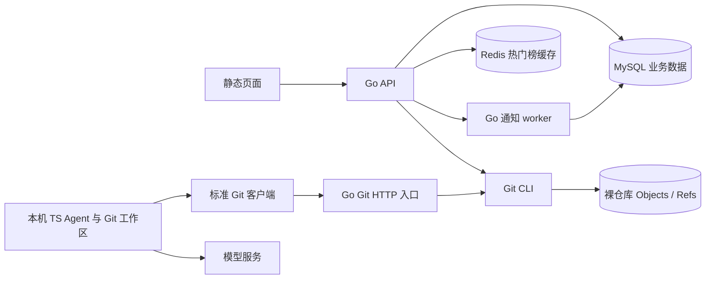

# GitNova：Go 与原生 Git 重构方案

日期：2026-11-06。目标：在找第一次后端实习的时间窗口内，完成能运行、能验证、能独立讲清楚的项目。Go 已确定为后端方向，本方案不再讨论是否换语言。

## 约束与起点

- 最多一个月，每周约 30 小时，按四周 **120 小时**分配；其中实际功能开发 92 小时、交付与求职准备 16 小时、风险缓冲 12 小时。这是预算，不是已经验证的工期。
- 用户亲自实现业务代码。此次交付是项目审核和实施方案，不是代写后端。
- 不划分产品版本；下文是同一目标下的开发依赖和时间安排。
- 旧 Gitlet 只有开发测试数据：保留旧代码与数据备份，不开发历史转换器，不承诺旧对象 ID 连续。
- 原工作树 `/Users/zhaoguodong/code/GitNova`，分支 `refactor/harness-in-sandbox`；既有 Go 工作树 `/Users/zhaoguodong/code/GitNova-go`，分支 `feat/go-backend`。二者已提交基线均为 `27c0487bb14f9d9eff25561dddffb9ca55cdb92a`。
- 原树的 Java 认证和 TS Agent 有未提交工作，Go 树没有这些改动。本次没有复制、提交、撤销它们。
- 审核证据见[审核报告](/Users/zhaoguodong/code/GitNova-go/docs/go-refactor/审核报告.md)，逐路径处置见同目录 `source-inventory.csv`。

## 本月要交付的实际使用链路

用户注册登录 → 编辑公开资料 → Home 查看自己拥有和参与的仓库、收藏及热门榜 → 创建仓库并用标准 Git 客户端 Push/Clone → 浏览代码、Star 收藏、Watch 订阅 → 创建和合并 PR → 订阅者收到站内通知并标为已读。

个人主页与 Home 是业务起点。Home 分开呈现我的仓库、我的收藏和公开热门仓库，导航放通知入口和未读数。仓库页用独立的 Star 和 Watch 操作。界面沿用现有静态 HTML/JS。

TS Agent 通过本机 CLI 在指定提交的临时 Git 工作区完成一次代码任务。用户检查 Diff 后用标准 Git 将结果推到工作分支，再从页面创建 PR。原本分给 Agent 网页任务编排的 20 小时转给 Star、Watch、通知和热门榜。托管任务、容器执行、SSE 与会话恢复接在这条交付链之后。旧施工单继续记录 Follow、关注动态、行级 Review 和更细的 Watch 偏好。

## 技术选择与职责

| 部分 | 采用方案 | 责任 |
|---|---|---|
| Go HTTP | `net/http`、标准路由、显式中间件与构造函数 | 请求解析、认证、响应和 Git HTTP 接入 |
| 持久化 | MySQL、`database/sql`、`go-sql-driver/mysql`；用现成 SQL migration 工具管理顺序 | 明确 SQL、索引、事务和受影响行数；不逐类翻译 MyBatis |
| 认证 | BCrypt；浏览器 JWT；Git 客户端使用可撤销访问令牌 | JWT 的 `sub` 为用户 ID；Git 令牌保存摘要并绑定权限 |
| Git 引擎 | 系统 Git、标准裸仓库、Git Smart HTTP | 对象、Pack、Refs、遍历、Diff、合并算法交给 Git |
| Agent | 现有 TS Core + 本机 CLI | 补齐 Loop 和 Session，验证模型、工具、历史、取消及固定提交上的代码任务 |
| 通知 | MySQL Outbox + Go 进程内单个投递 worker | PR 事务记录事件，worker 按当前订阅与权限写通知 |
| 展示 | 现有静态页面 + JSON API | Home、收藏、热门榜、仓库、PR 和通知 |
| Redis | 热门榜候选结果缓存 | 以 MySQL 重算为兜底，展示前从 MySQL 核对仓库当前可见性 |

依赖版本在建立 `go.mod` 时确认兼容性并锁定，本文不根据旧环境记录臆定版本。参考 Gitea 的 Git 命令封装、鉴权入口与 PR 边界，不将其 `modules/git` 整包导入。OneDev 的业务设计可作为参考；这次没有本地 OneDev 源码可供重新核验。



Go 负责业务 API 和仓库授权。TS Core 可以在临时目录配合假模型独立测试。CLI 和网页通过标准 Git 工作分支衔接。

## 建议目录与一次请求的写法

在既有 Go 工作树新增 `backend-go/`，保留现有 Java 代码作行为参考。迁移成功前不删除旧目录。

```text
backend-go/
  cmd/server/main.go             # 创建依赖、挂路由、启动与关闭
  cmd/gitnova-hook/main.go       # Git 接收前的分支策略校验入口
  internal/auth/                 # handler / service / store / dto
  internal/user/
  internal/repository/          # 仓库权限、Star、Watch、热门查询
  internal/git/                  # 固定 Git 命令与 HTTP 协议桥接
  internal/pullrequest/
  internal/notification/        # 事件投递、收件箱和未读数
  internal/httpapi/              # 中间件、错误响应、路由装配
  internal/config/
  migrations/
  web/                          # 从现有 static 迁入并适配
agent-runtime/agent-core-ts/     # TS 内核和本机 CLI
```

按功能建包，不先创建几十个空文件。`handler → service → store 或 Git 调用 → handler 返回 DTO`；`main` 创建真实对象并传入依赖。只在确实需要替身/适配时定义小接口，不为每张表机械创建 interface/impl。

每项业务按同一流程推进：**输入与权限规则 → 表/索引或 Git 操作 → Service → Handler/DTO → 正常与失败测试 → 页面接线与演示**。DTO 是接口契约，不是数据库实体的自动序列化。

## 数据归属与旧代码处置

| 当前资产 | 新实现中的处理 |
|---|---|
| `AuthService`、JWT 拦截器 | 在 Go 重写行为；确认 `sub=userId`，不搬回旧 `username + userId claim` 契约 |
| `RepoService`、成员权限 SQL | 保留规则，在 Go 加入创建状态、原生仓库初始化、当前 ACL 与分页 |
| `gitlet/`、`gitobject/`、`transfer/`、`storage/` | 不翻译到 Go；由标准 Git 引擎替代。原代码留在历史/参考树 |
| `branch.head_commit` | 不进入新库的权威状态；分支 HEAD 只认 Git Ref |
| `commit_record` 与仓库 HEAD 缓存 | 不要求先建索引；从 Git 读取。未来缓存只能是可重建投影 |
| `entity/agent`、`mapper/agent`、旧 Java 协议 | 提取唯一约束、幂等和失败语义；不继承整个旧状态机 |
| TS Model/Gateway/Registry/Bash 代码 | 保留，补循环、运行入口、Host 和隔离适配 |
| 旧 Agent Worker POM | 仅历史配置；当前没有 Worker 主类源码，不能当可执行 Worker |
| Lua 限流脚本、业务测试场景 | 可复用算法和验收场景；替换 Spring/Redis 客户端绑定 |
| 静态页面 | 复用 API 客户端与交互，接入资料、代码、Star、Watch、热门榜、通知和 PR |
| 历史评测 | 保留任务与验收器；驱动要适配新接口，旧指标不能标为 Go/TS 的实测结果 |

新库使用独立的 `gitnova_go_dev`，不让 Go 执行旧 Java 的 Flyway 历史。旧库不删表。新迁移目录的数字只表示数据库迁移顺序，与产品版本无关。

建议先建实际用到的表：

| 表 | 主要字段与约束 |
|---|---|
| `users` | `id, username, password_hash, email, display_name, bio, location, website, created_at`；username 唯一；公开 DTO 不含 email/hash |
| `repositories` | `id, owner_id, name, visibility, default_branch, status, created_at, deleted_at`，owner/name 唯一。分支 HEAD 从 Git 读取 |
| `repo_members` | `repo_id, user_id, role`；联合唯一，反向 user/repo 索引；owner/collaborator 足够 |
| `access_tokens` | `id, user_id, secret_hash, repo_id, allowed_ref, scope, expires_at, revoked_at`，为 Git 操作绑定仓库和权限 |
| `repo_stars` | `repo_id, user_id, created_at`，主键 `(repo_id, user_id)`。收藏列表索引 `(user_id, created_at, repo_id)`，热门聚合候选索引 `(created_at, repo_id)` |
| `repo_watches` | `repo_id, user_id, created_at`，主键 `(repo_id, user_id)`。一行表示订阅该仓库的 PR 创建和合并 |
| `pull_requests` | `id, repo_id, author_id, source_ref, target_ref, title, status, source_oid, target_oid, merged_oid, created_at`；源/目标固定 OID 用于展示与提交校验 |
| `merge_operations` | `id, pr_id, expected_source_oid, expected_target_oid, candidate_oid, status`；记录 Git 更新与数据库状态之间的恢复依据 |
| `repo_event_outbox` | `id, repo_id, pr_id, kind, actor_id, occurred_at, next_attempt_at, processed_at`。`(pr_id, kind)` 唯一，`(processed_at, next_attempt_at, id)` 支持扫描待投递事件 |
| `notifications` | `id, recipient_id, event_id, repo_id, pr_id, kind, created_at, read_at`。`(recipient_id, event_id)` 唯一，按 `(recipient_id, created_at, id)` 分页，按 `(recipient_id, read_at)` 查未读 |

基本资料与账户同生命周期，放 `users`，单独设计 `UserProfileResponse`。不先拆 `user_profile`。本月用默认头像，不引入头像上传与对象存储系统。

## HTTP 与 Git 接口边界

| 功能 | 接口与关键约束 |
|---|---|
| 注册/登录 | `POST /api/auth/register`、`POST /api/auth/login`；JSON 请求；BCrypt 按 UTF-8 字节限制输入，数据库唯一冲突返回可理解错误 |
| 当前用户/编辑资料 | `GET /api/me`、`PATCH /api/me/profile`；可写字段白名单，不能改角色/内部状态 |
| 公开主页 | `GET /api/users/{id}`、`GET /api/users/{id}/repositories`；owner 与 viewer 分离，公开 DTO，当前 ACL 过滤 |
| Home | `GET /api/me/repositories?scope=owned\|participating&cursor=...&limit=...`；不混入无关公共仓库 |
| 仓库 | `POST /api/repos`、`GET/PATCH/DELETE /api/repos/{id}`。owner 可修改可见性，删除记录为软删除 |
| 成员 | `PUT/DELETE /api/repos/{id}/members/{userId}`；owner 才能管理，变更后权限即时生效 |
| Star | `PUT/DELETE /api/repos/{id}/star`、`GET /api/me/stars`。按当前权限返回收藏列表，仓库详情返回 `starred` 和 `starCount` |
| Watch | `PUT/DELETE /api/repos/{id}/watch`。仓库详情返回 `watching` |
| 热门榜 | `GET /api/repos/trending`。返回近 7 天获得有效 Star 的公开仓库 Top 20 |
| 通知 | `GET /api/me/notifications`、`GET /api/me/notifications/unread-count`、`PUT /api/me/notifications/{id}/read`。列表、未读数与标读使用同一授权条件 |
| Git 凭据 | `POST/DELETE /api/me/git-tokens`。仅创建时展示明文，撤销后新请求重新查授权 |
| 代码浏览 | `GET /api/repos/{id}/branches`、`/commits`、`/tree`、`/file`、`/diff`；先解析 ref 到 OID，再以固定 OID 读取 |
| PR | `POST/GET /api/repos/{id}/pulls`、`GET .../pulls/{prId}`、`GET .../pulls/{prId}/diff`、`POST .../pulls/{prId}/merge`、`POST .../pulls/{prId}/close` |
| Git Smart HTTP | `GET /git/{id}.git/info/refs?service=...`、`POST /git/{id}.git/git-upload-pack`、`POST /git/{id}.git/git-receive-pack`；不套 JSON 响应 |

普通 JSON API 保留 `code/message/data` 的现有外壳便于适配页面，但 HTTP 状态必须正确；前端相应切换 JSON body。长整数 ID 对外使用十进制字符串，时间用带时区的 RFC3339。列表使用稳定 keyset，最多 50 条，取 `limit+1`；游标绑定 viewer、筛选条件和排序，每次请求重新查 ACL，统计使用同一可见性条件。

## 必须写对的实现边界

### 原生 Git 托管

1. 仓库目录由授权后的数据库 ID 决定，例如独立数据根下 `repos/42.git`。不接受客户端绝对路径。Git 使用参数数组和限定环境启动，不拼 shell 字符串。
2. 创建先落 `CREATING` 及 owner 关系，再在事务外 `git init --bare`，最后改 `READY`。失败保存可诊断状态；重试检查已有目录，避免“数据库成功、仓库不存在”。Home 只列可用仓库。
3. Git 对象和 Refs 是唯一代码事实；MySQL 记录用户、权限、PR 和任务。服务启动核对 Git 可执行文件和数据根。
4. HTTP 入口分别检查读写权限，Git 客户端用 Basic 携带访问令牌；浏览器 JWT 不会自动被 Git 客户端使用。仅 TLS/本机回环传送凭据。
5. 建议参考 Gitea 的 Smart HTTP 适配：Go 完成鉴权与 HTTP 封装，将请求流交给 `git upload-pack/receive-pack --stateless-rpc`，GET discovery 使用对应 `--advertise-refs`。不自行处理对象协商或 Pack 解码。
6. 网关必须覆盖 chunked 请求、必要的 gzip、正确 MIME、Git 协议头、输入/输出上限、超时、客户端中断及进程树回收。不能把一次小文件 Push 成功当全部验收。Go 标准 `net/http/cgi.Handler` 本地源码明确拒绝 chunked 且未绑定请求 Context，不能不加处理就当完整方案。
7. `pre-receive` 检查整批 ref 的权限、允许分支、非快进和保护策略。认证身份取自 Go 鉴权入口。默认分支初始化和后续写入分别校验。
8. 单 Go 实例中的 Push、PR 创建与合并、成员与可见性变更、删除、Star 与 Watch 写入共用按 repo 的写门闩，获得门闩后核对当前权限。HTTP 入口负责持有 Push 门闩，hook 负责校验 ref。Git `update-ref old→new` 负责引用的 CAS。
9. 浏览直接读 Git，不依赖 push hook 更新数据库索引。`post-receive` 只作附加业务通知；不能用其失败回滚已成功的 Push。需可靠的新业务事件单独落持久状态并可重查 Git。

### TS Core 与本机 Git 任务

1. 补齐 `AgentLoop.run` 和 `AgentSession.prompt/run`，完成用户输入 → 模型 → 工具 → 工具结果进入历史 → 再次调用模型 → 终态。验收取消、工具异常、模型轮数上限和无最终响应。
2. 以 `message_end` 提交完整消息到 Session 历史，并保留 provider replay 数据。先用确定性的假模型和工具测试历史顺序，再用真实模型执行一个受控小任务。
3. 用标准 Git Clone 创建临时工作区，检出用户指定的提交后运行 TS CLI。演示使用受信任的本机样例。工具子进程使用明确的环境变量白名单和超时。用户审查 Diff 后执行 Commit 和 Push，再从 Go 页面创建 PR。

后续接入托管任务时，由 Node Host 装配 Core 和容器工具。Go 负责独立工作区、任务状态、进程监督、取消、持久事件和 SSE 重放。用已完成的 CLI 任务作为端到端用例。

### PR 与 Git/MySQL 一致性

- 只做同仓库 PR：创建、列表/详情、固定提交 Diff、关闭、人工合并。源分支更新使旧合并预览失效，客户端带已查看的 source/target OID；不静默合并另一份代码。
- 合并计算用 `git merge-tree --write-tree`；存在冲突返回 409 并保留分支。创建真实的双父 Git Commit，选择一种明确的 merge-commit 策略，暂不增加多种策略 UI。
- 计算完成后进入仓库写门闩，重新查权限与两个 ref；变化则拒绝并要求刷新。`update-ref target candidate expectedOld` 负责最后 CAS。
- 先持久化 `merge_operations` 的候选 OID 与预期 HEAD，再更新 Git，再更新 PR 状态。事务不能跨 Git 文件系统提供原子性；需要用记录恢复中断点。
- 启动恢复时：候选已成为目标或目标祖先则补记合并；目标仍为旧值则标记未应用；无法判断时保留待核对状态并阻止重复合并。不自动重复生成/推进分支，也不覆盖别人的新提交。

### Star、Watch、通知与热门仓库

1. **Star 记录收藏。** 已登录用户可以收藏当前可读的仓库。写入以 `(repo_id, user_id)` 唯一约束兜底，重复 `PUT` 保留原收藏时间。按关系表聚合 `starCount`，通过收藏关系与仓库当前 ACL 联查后分页。取消操作按当前用户删除自己的关系，统一返回 `204`，让已撤权的用户仍能清理自己的收藏。
2. **Watch 记录订阅。** 订阅与取消分别通过 `PUT` 和 `DELETE` 表达，权限规则与 Star 一致。Watch 关系独立写入。订阅的事件类型为 `PR_OPENED` 和 `PR_MERGED`，用户在仓库页能看到自己的订阅状态。
3. **通知从 PR 业务事务产生。** 创建 PR 与插入 `PR_OPENED` 在同一 MySQL 事务提交。Git 合并确认成功后，PR 状态、合并记录和 `PR_MERGED` 在同一 MySQL 事务提交，恢复流程复用这一入口。`(pr_id, kind)` 作为本月两类事件的唯一键。
4. **投递走 MySQL Outbox。** Go 的一个后台 worker 每次处理一条到期事件，在短事务里按当前 Watch 和 ACL 筛选接收者，排除操作者以及事件发生之后才订阅的人，批量插入通知并标记事件已处理。通知使用 `(recipient_id, event_id)` 去重并保留原已读状态。失败后回滚处理事务，更新下次重试时间并记录事件 ID 和错误。服务重启后扫描仍待处理的记录。
5. **通知查询与标读校验当前权限。** 列表和未读数在 SQL 中同时限定接收者和仓库 ACL，再分页或计数。标读按相同条件更新 `read_at`，重复标读保留原时间。仓库私有化或成员撤权提交后的新请求用当前 ACL 过滤历史通知。
6. **热门榜按近 7 天有效 Star 排序。** 统计 UTC 时间窗口内仍有效的 Star 行，筛选公开、`READY`、未删除的仓库，按分数降序和仓库 ID 降序取 Top 20。`(created_at, repo_id)` 是查询的候选索引，用实际数据和 `EXPLAIN` 核对扫描范围与排序开销。 [MySQL 联合索引说明](https://dev.mysql.com/doc/refman/8.4/en/multiple-column-indexes.html)
7. **Redis 缓存榜单候选。** 缓存仓库 ID 与分数，写缓存时附带 60 秒 TTL。命中后批量从 MySQL 查当前公开仓库并按缓存顺序组装，私有化后本次结果可以少于 20 条。Redis 缺失或超时走 SQL。收藏关系与仓库详情的即时计数读 MySQL，热门排名按缓存周期刷新。 [Redis SET 与过期参数](https://redis.io/docs/latest/commands/set/)

仓库关系和收件箱的约定来自现有施工单。本方案采用显式 Watch，投递集中在两类 PR 事件，工时覆盖单进程 worker。 [Star 和 Watch 约定](/Users/zhaoguodong/code/GitNova/docs/harness-refactor/14_主页与Follow_Star_Watch_详细施工单.md:43) · [通知事件与权限](/Users/zhaoguodong/code/GitNova/docs/harness-refactor/15_Outbox_通知与动态_详细施工单.md:54) · [Gitea Star](/Users/zhaoguodong/code/gitea/models/repo/star.go:29) · [Gitea Watch 接收者](/Users/zhaoguodong/code/gitea/models/repo/watch.go:249)

## 120 小时任务表

每一项包含必要的测试和页面接线，不把所有验证堆到最后。

| 任务 | 小时 | 具体产出 | 完成判据 |
|---|---:|---|---|
| A Go 请求链与工程入口 | 8 | `go.mod`、main、配置、HTTP、MySQL 连接、迁移、错误响应 | 能亲手解释请求如何到 Handler/Service/SQL，测试无需整套服务启动 |
| B 认证、个人主页、Home、仓库权限 | 14 | 用户 DTO、资料更新、JWT、仓库元数据、成员与列表 | 两个账号看到不同的私有仓库；资料无敏感字段；唯一冲突/分页/撤权有测试 |
| C 原生 Git 与代码浏览 | 22 | 裸仓库、Git 凭据、Smart HTTP、文件/提交/分支/Diff 页面 | 标准 clone/push/fetch 成功；无权限写入失败；大请求/取消/空仓库正确 |
| D TS Core 与本机 Git 任务 | 16 | Loop、Session、历史、限制与取消，固定提交的 CLI 演示 | 假模型测试覆盖两次模型调用，真实模型完成受控任务，产出可审查的 Git Diff |
| E 用户侧功能 | 20 | Star 4 小时、Watch 3 小时、站内通知 9 小时、热门榜 4 小时 | 重复操作幂等，真实 PR 产生通知，撤权后历史通知受限，热门缓存可回源 |
| F PR 闭环 | 12 | PR、固定 Diff、merge-commit、CAS、失败恢复 | 正常合并、冲突、源/目标更新、Git 成功后数据库失败都有验收 |
| G 交付与求职准备 | 16 | 串联页面、单机部署、端到端脚本、演示、简历与讲解 | 陌生环境按说明可运行；演示不靠手改库；每条简历结论有代码/测试依据 |
| 风险缓冲 | 12 | 处理集成问题与学习超时 | 不提前拿来扩展功能 |
| **合计** | **120** | **功能 92 + 交付 16 + 缓冲 12** | |

建议周安排：

| 时间 | 工时组合 | 应看到的结果 |
|---|---|---|
| 第 1 周 | A 8 + B 14 + D 4 + G 4 | Go 业务请求可跑；资料/Home 初步接线；开始准备简历和投递，准确标明 Go 实现进度 |
| 第 2 周 | C 22 + Star 4 + Watch 3 + 热门榜 1 | 标准 Git 往返和浏览，收藏与订阅，热门 SQL 查询 |
| 第 3 周 | F 12 + 通知 9 + 热门榜 3 + D 6 | PR 与通知投递，热门缓存和回源，Agent 循环测试 |
| 第 4 周 | D 6 + G 12 + 缓冲 12 | 固定提交的本机 Agent 演示，用户侧全链路与故障验收，部署和面试准备 |

投递从第 7–10 天开始，不等第 120 小时才开始。简历先写已经验证的能力，未完成的 Go 功能不写成已交付。

仓库与权限完成后开发 Star、Watch。热门榜依赖 Star。通知依赖 Watch 以及 PR 事务产生的事件，可以先用 `PR_OPENED` 验证投递，再接入合并。TS Core 提前验证，最后用已有 Git 远端和 PR 入口串联演示。

超过预算时先停止扩展和界面装饰，使用缓冲修复主链路。若缓冲仍不足，要明确报告哪项交付做不到，不能省略权限、取消、一致性测试后继续声称完成。不得临时新增另一套框架或再重写 TS Core。

## 每次交付的验证方法

1. Go：`gofmt`、`go vet ./...`、`go test ./...`；涉及并发再跑相应包 `go test -race`。SQL 行为用独立测试库，不连接旧开发库修改数据。
2. Git：临时裸仓库与真实 Git 客户端；测试 HTTP 协议和权限，不能只 mock Git 命令返回。
3. Core 假模型测试覆盖工具执行、取消、最大轮数、异常和历史顺序。真实模型在固定提交上修复一个带测试的小任务，审查 Diff 后 Push 工作分支并从网页创建 PR。
4. 用户侧用真实仓库演示。A 创建公开仓库，B 收藏与订阅，A 打开并合并 PR。B 收到两条通知并标读一条。A 将仓库设为私有后，B 的收藏列表、通知列表及剩余未读数过滤该仓库，热门榜在缓存命中时也过滤它。给 B 仓库权限后验证私有 Git 访问，撤权后再验证访问限制。
5. 故障测试覆盖并发 Star 只保存一条关系、重复 Watch 保留首次订阅时间、取消订阅后停止接收新事件、越权标读被拒绝、PR 事务回滚时事件一并回滚、worker 重启补投与重复投递去重、Redis 停止时 SQL 回源、源或目标 HEAD 竞争，以及 Git 更新成功而 SQL 提交失败后的恢复。
6. 简历材料：保留一次真实演示、关键测试输出、架构图和一页技术取舍。没有测量就不写吞吐/提升百分比，旧 Java 评测与新 Go/TS 实测分开。

## 工作树与切换操作

- 继续使用已经存在的 `feat/go-backend` 工作树，不额外创建相同用途的分支。
- 原树 TS WIP 由用户继续完成；需要带入 Go 树时，只提交选定 TS 路径，再移入该提交。不要跨树递归覆盖，不把认证 WIP 一起打包。
- Go 使用独立端口（建议 8081）、数据库、Redis 前缀和仓库/工作区根。工作树不会隔离这些运行资源。
- 真正切换前备份旧开发数据库与 `data/`，先记录实际位置与大小；本次没有执行数据备份或删改。
- 切换验收后再改默认 README、启动命令和部署入口。旧 Java 文档标历史参考；无需把数万字旧施工文档全部翻译成 Go 才开始开发。
- 本轮只添加审核材料，没有创建业务骨架、运行迁移、提交或推送。

## 下一次手写工作的入口

先完成 A 的 `GET /healthz`、配置与数据库迁移，再写 B 的 `注册 → 登录 → GET /api/me`。`main` 显式装配 SQL Store、User Service 和 Handler。认证中间件从 Token 取 actor，Service 读取用户并映射本人 DTO，Handler 返回状态码和 JSON。用同一请求链完成资料编辑与 Home 的权限分页。仓库可读后，用 `PUT/DELETE /api/repos/{id}/star` 作为第一个用户互动模块，验收两个并发请求只保存一条收藏关系，再写收藏列表与热门聚合。

参考资料已在方案中消化，以下用于实施时精确核对 API，不是阅读前置作业：

- [Go HTTP](https://pkg.go.dev/net/http)、[SQL 事务](https://go.dev/doc/database/execute-transactions)、[子进程与取消](https://pkg.go.dev/os/exec#CommandContext)。
- [Git HTTP](https://git-scm.com/docs/git-http-backend)、[Hooks](https://git-scm.com/docs/githooks)、[merge-tree](https://git-scm.com/docs/git-merge-tree)、[update-ref](https://git-scm.com/docs/git-update-ref)。
- 本地 Gitea 的 [HTTP RPC 转发](/Users/zhaoguodong/code/gitea/routers/web/repo/githttp.go:368) 与 [Git 模块依赖](/Users/zhaoguodong/code/gitea/modules/git/repo.go:18)。
